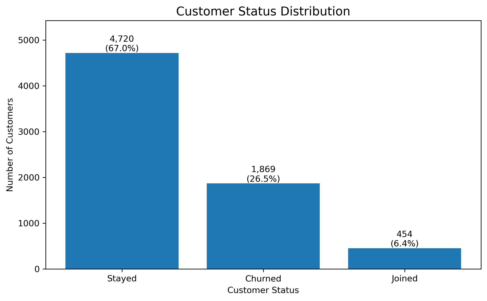
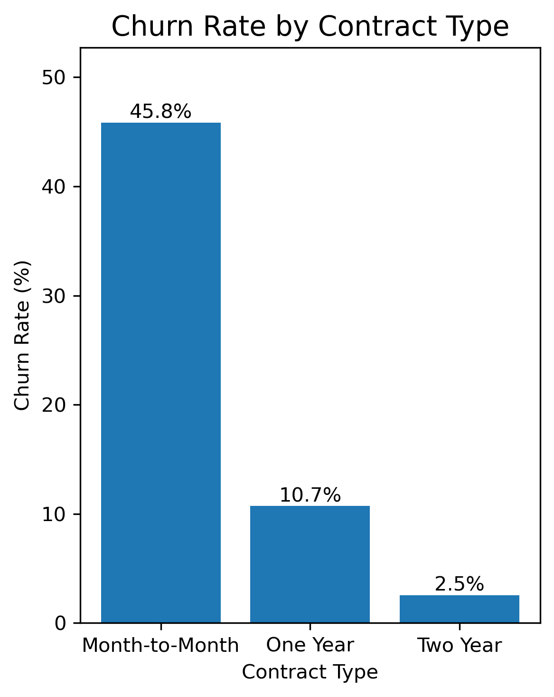
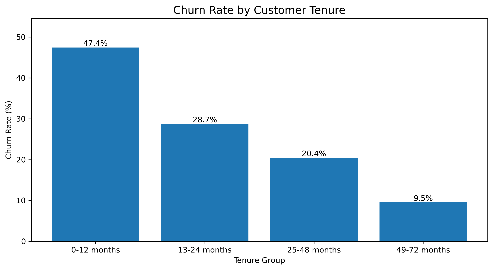
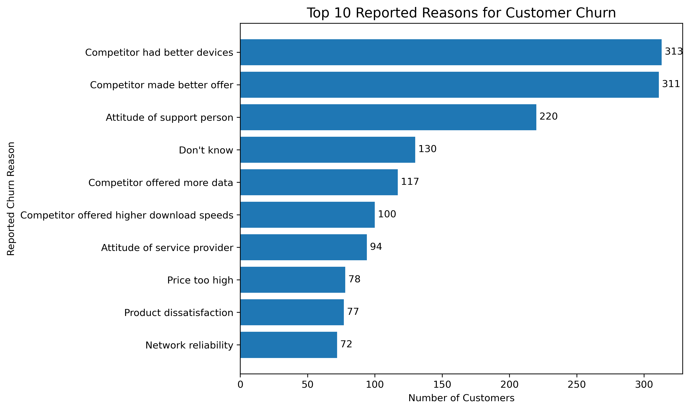

# Telecom Customer Churn Analysis

## Project Overview

This project investigates customer churn patterns in a telecommunications company dataset containing 7,043 customer records. Using Python, SQL, and data visualization, the analysis explores customer status, contract types, tenure, monthly charges, and reported reasons for churn.

The goal is to identify customer groups associated with higher churn, understand the reasons customers report for leaving, and develop evidence-based recommendations to support customer retention.

## Business Problem

Customer churn can affect revenue, customer relationships, and long-term business growth. The company needs to understand which customer groups have higher churn rates and what reported issues may contribute to customers leaving.

This project uses exploratory data analysis and SQL to investigate those patterns and translate the findings into practical business recommendations.

## Tools Used

- **Python:** Data cleaning, exploratory data analysis, and visualization
- **pandas:** Data manipulation and analysis
- **Matplotlib:** Charts and visualizations
- **SQL (SQLite):** Customer segmentation, aggregations, and churn-rate calculations
- **Jupyter Notebook:** Analysis workflow and documentation
- **GitHub:** Project version control and presentation

## Project Workflow

1. Audited the dataset for missing values, duplicates, and potential data-quality issues.
2. Cleaned missing values where the dataset's business definitions supported a correction.
3. Explored customer status, tenure, contract types, services, and monthly charges.
4. Used SQL to analyze churn across customer segments and reported churn reasons.
5. Created visualizations to communicate the main findings.
6. Developed business recommendations and documented analytical limitations.

## Key Findings

### 1. Contract Type and Churn

- Month-to-month customers had a churn rate of **45.84%**.
- One-year contract customers had a churn rate of **10.71%**.
- Two-year contract customers had a churn rate of **2.55%**.

### 2. Customer Tenure

- Customers with 0–12 months of tenure had the highest observed tenure-group churn rate, at **47.44%**.
- The churn rate declined across the longer tenure groups, reaching **9.51%** among customers with 49–72 months of tenure.

### 3. Reported Reasons for Churn

- Competitor-related reasons accounted for **45.00%** of churned customers.
- Dissatisfaction accounted for **17.17%**.
- Attitude-related reasons accounted for **16.80%**.
- Price accounted for **11.29%**.

### 4. Monthly Charges

Customers who churned had higher average monthly charges than customers who stayed within each of the three contract types. This is an observed association, not proof that higher charges caused churn.

## Visualizations

### Customer Status Distribution

This chart shows the distribution of customers who stayed, churned, or joined.

### Churn Rate by Contract Type

Month-to-month customers had a substantially higher churn rate than customers on one-year or two-year contracts.

### Churn Rate by Tenure

Customers with 0–12 months of tenure had the highest observed churn rate among the tenure groups.

### Top Reported Churn Reasons

Competitor-related reasons were the largest category of reported churn reasons in the dataset.

## Business Recommendations

1. **Focus on newer customers:** Investigate onboarding and early service experiences, especially for customers with month-to-month contracts.
2. **Review competitive positioning:** Compare available devices, data allowances, internet speeds, and offers with those of competitors.
3. **Improve customer support:** Investigate support-related complaints and identify opportunities to improve service interactions.
4. **Investigate pricing concerns:** Review billing clarity, long-distance charges, and extra-data charges.
5. **Measure retention initiatives:** Track outcomes to determine whether proposed changes actually improve customer retention.

## Limitations

- This is descriptive analysis and does not establish causation.
- Customer-reported churn reasons reflect the reasons recorded in the dataset and may not explain every factor behind a customer's decision.
- The analysis uses the available dataset; results may not generalize to other telecommunications companies or future periods.
- Some monthly charge values were negative and were treated as missing because their cause could not be established from the available data.

## Conclusion

The analysis identified higher observed churn among month-to-month customers and customers with shorter tenure. Competitor-related reasons were the largest reported churn category. These findings suggest that early customer experience, competitive positioning, service quality, and perceived value deserve further investigation.

The results provide a starting point for targeted retention initiatives, which should be evaluated using measurable business outcomes.
